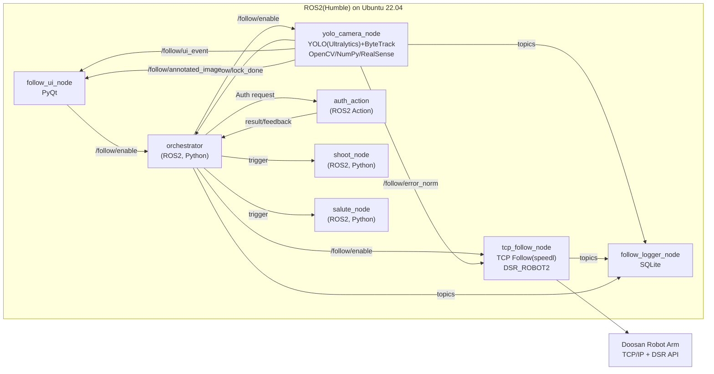
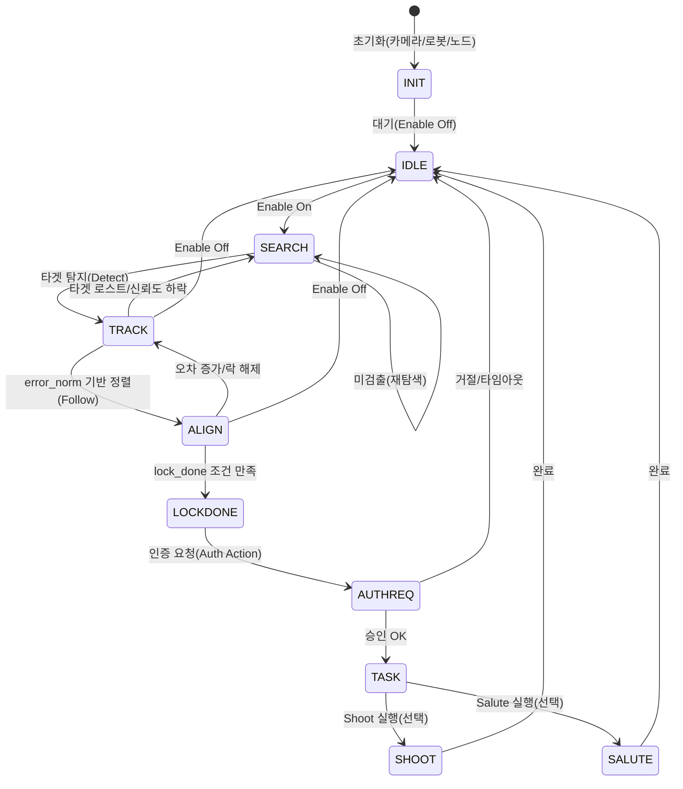

# 경계시스템 자동화 구현 프로젝트 (Eye-in-Hand Camera)
> **Vision(Detect+Track) → 정규화 가이던스(error_norm) → TCP Follow(speedl) → 인증(Auth Action) → Task(Shoot/Salute)**  
> 카메라는 **로봇팔 말단(End-Effector)에 장착(Eye-in-Hand)** 된 구성을 전제로 합니다.

---

## 1. 프로젝트 개요
카메라로 **대상 객체를 탐지(Detection)** 하고 **동일 객체를 추적(Tracking)** 한 뒤,  
추적 결과를 **정규화 오차(error_norm)** 로 변환하여 로봇 TCP가 목표를 실시간 추종합니다.  
또한 작업 전 **인증(Action 기반 Auth Gate)** 를 통해 승인된 경우에만 **Shoot/Salute 작업 노드**를 실행하는 구조입니다.

- Vision 노드: **YOLO(Ultralytics) + ByteTrack + OpenCV/NumPy + RealSense**
- Control 노드: **speedl 기반 TCP Follow (Doosan DSR_ROBOT2)**
- Coordination: **orchestrator**가 전체 흐름(Enable/LockDone/Task)을 제어
- Auth Gate: **auth_action (ROS2 Action)** 로 승인/인증 흐름 제공
- UI: **PyQt 기반 모니터링/제어**
- Logging: **SQLite 기반 세션/이벤트 로깅**

> (확장) TTS/ASR 음성 게이트는 과거 설계안으로, 필요 시 Auth Gate와 대체/병행 가능합니다.

---

## 2. 하드웨어/센서 구성
### Eye-in-Hand(핸드 장착 카메라) 특징
- 카메라가 로봇팔과 함께 움직이므로 프레임마다 시점이 변합니다.
- 안정적인 판단을 위해 **좌표 변환(TF)** 과 **캘리브레이션(이미 수행)**이 중요합니다.

#### 권장 좌표계
- `base` : 로봇 베이스
- `ee` : 엔드이펙터(플랜지/툴 프레임)
- `camera` : 카메라 프레임(EE에 고정)
- (선택) `target` : 추적 대상 객체의 추정 포즈

---

## 3. 실행 엔트리포인트 (setup.py)
```text
tcp_follow          = cobot2.tcp_follow_node:main
yolo_camera         = cobot2.yolo_camera_node:main
auth_action         = cobot2.auth_action_server:main
salute              = cobot2.salute_node:main
shoot               = cobot2.shoot_node:main
orchestrator        = cobot2.orchestrator:main
follow_ui_node      = cobot2.follow_ui_node:main
follow_logger_node  = cobot2.follow_logger_node:main
```

---

## 4. 전체 아키텍처 (실구동 기준)


---

## 5. 상태 머신(동작 흐름) — Tracking 중심


---

## 6. 노드별 핵심 역할

### 6.1 `yolo_camera_node`
- YOLO + ByteTrack 기반 객체 탐지/추적
- Aim point 계산 및 **error_norm(-1~1)** 정규화
- lock_on / lock_done 판단
- UI용 annotated image 및 이벤트 publish
- `/follow/enable`이 False면 추론/락 상태 리셋 + error_norm (0,0)

### 6.2 `tcp_follow_node`
- `/follow/error_norm` 수신 → deadzone + EMA 필터 → 속도 매핑
- speedl 기반 TCP 추종
- 안전 제한(예):
  - enable off 즉시 speedl 0
  - target timeout 자동 정지
  - Base Y/Z 제한, J4 하한 + hold

### 6.3 `orchestrator`
- 시스템 상위 상태 제어(Enable/LockDone/Task 트리거)
- Auth 결과에 따라 Task 진행 여부 결정
- shoot/salute 실행 조건 및 순서 관리

### 6.4 `auth_action_server`
- ROS2 Action 기반 인증/승인 게이트
- 결과(Result)/피드백(Feedback)을 orchestrator가 받아 작업 진행 여부 결정

### 6.5 `shoot_node` / `salute_node`
- orchestrator 트리거 기반 Task 수행 노드
- 로봇 제어(Doosan SDK) 호출 및 상태 피드백 연동 가능

### 6.6 `follow_ui_node` (PyQt)
- 상태 표시: `/follow/ui_event`, `/follow/annotated_image`
- 제어: Enable 토글, 작업 버튼(오케스트레이터 명령)

### 6.7 `follow_logger_node` (SQLite)
- 세션 기반 이벤트/스냅샷 기록(디버깅/재현용 타임라인)

---

## 7. 통신 구조(핵심 토픽)
### Control 핵심
- `/follow/error_norm` (Float32MultiArray)
- `/follow/enable` (Bool)
- `/follow/lock_done` (Bool) — late-joiner 대응 위해 transient local 권장

### UI/모니터링
- `/follow/annotated_image` (sensor_msgs/Image)
- `/follow/ui_event` (String 또는 커스텀)

### 로깅
- logger가 주요 토픽들을 subscribe하여 SQLite에 저장(세션/스냅샷)

---

## 8. Eye-in-Hand 캘리브레이션/좌표 변환(필수)
### 8.1 Hand-Eye(EE->Camera) 고정 변환
- `T_ee_camera` (static TF): 카메라가 EE에 고정이므로 **한 번 캘리브레이션 후 고정**해서 사용

### 8.2 프레임 변환 흐름(권장)
- 로봇에서 `T_base_ee`를 실시간 수신
- 고정 변환 `T_ee_camera`를 적용하여 `T_base_camera = T_base_ee * T_ee_camera`
- 비전 결과(예: bbox 중심 + depth 또는 pose)를 `camera`에서 얻고, 필요하면 `base`로 변환해 정책/동작에 사용

---

## 9. 권장 MVP 파라미터(초기값)
- Detect conf 임계치: `0.6 ~ 0.7`
- 로스트 허용 시간: `0.2 ~ 0.5s` (환경 FPS에 맞춰 조정)
- deadzone(error_norm): `0.02 ~ 0.05`
- EMA alpha: `0.2 ~ 0.4`
- lock_done 임계: `|ex|,|ey| < 0.05` (예시)
- lock_done 유지시간: `0.2 ~ 0.5s` (예시)

---

## 10. 실행 순서(권장)
1) Camera / RealSense 구동
2) `yolo_camera` 실행
3) `tcp_follow` 실행
4) `follow_ui_node` 실행(선택)
5) `follow_logger_node` 실행(선택)
6) `auth_action` 실행
7) `orchestrator` 실행
8) `shoot`, `salute` 실행(오케스트레이터가 트리거)

---

## 11. 기술 스택
- OS: Ubuntu 22.04
- Middleware: ROS 2 Humble, DDS
- Language: Python 3.10
- Vision: YOLO(Ultralytics), ByteTrack, OpenCV, NumPy
- Camera: RealSense(RGB/IR)
- UI: PyQt
- Robot: Doosan DSR_ROBOT2, speedl
- Logging: SQLite

---

## 12. 버전 관리 규칙
### 12.1 버전 번호 규칙
- 형식: **vX.XYZ**
  - `v0.X00` : **기능 구현 변화**(기능 추가/동작 흐름 변경)
  - `v0.0Y0` : **변수/상수/파라미터/리팩토링 변경**
  - `v0.00Z` : **버그 수정**
- 현재 프로젝트 베이스라인(권장): **v0.000**

### 12.2 코드 파일 상단 템플릿(필수)
모든 파이썬 파일 상단을 아래 순서로 통일합니다.

1) `# <filename> vX.XYZ YYYY-MM-DD` (1줄)  
2) `# [이번 버전에서 수정된 사항]` (1줄)  
3) 변경사항 불릿 목록  
4) 모듈 역할/흐름 docstring  
5) import 정렬  
6) ROBOT 상수 및 `DR_init.__dsr__id/__dsr__model` 설정을 DSR_ROBOT2 import 전에 배치  
7) `DEFAULT_` 상수 블록은 파일 상단에 모아두기

---

## 13. 개발 순서(권장 루트)
1) orchestrator 더미 입력으로 상태 전이 로그 확인  
2) yolo_camera 연결 → SEARCH/TRACK 진입 확인  
3) tcp_follow 연결 → error_norm→speedl 추종 안정화  
4) lock_done → Auth(Action) 게이트 연결  
5) shoot/salute Task 노드 연결(초기에는 드라이런/저속)  
6) SQLite logger 연결 → 세션 타임라인 저장  

---

## 14. 안전/운영 원칙
- Enable off는 어떤 상태에서도 최우선(즉시 정지)
- 인증(Auth Gate) 없는 Task 동작 금지
- 타겟 로스트 시 자동 정지/재탐색(동작 중에도 추적 유지)
- 핵심 이벤트는 모두 로그/DB로 남겨 디버깅 가능하게

---
